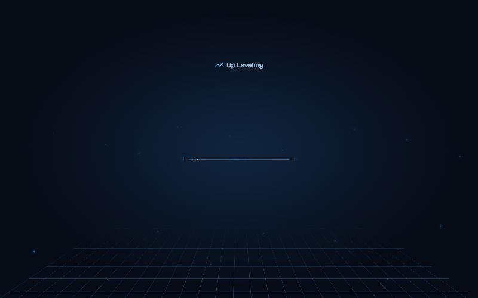
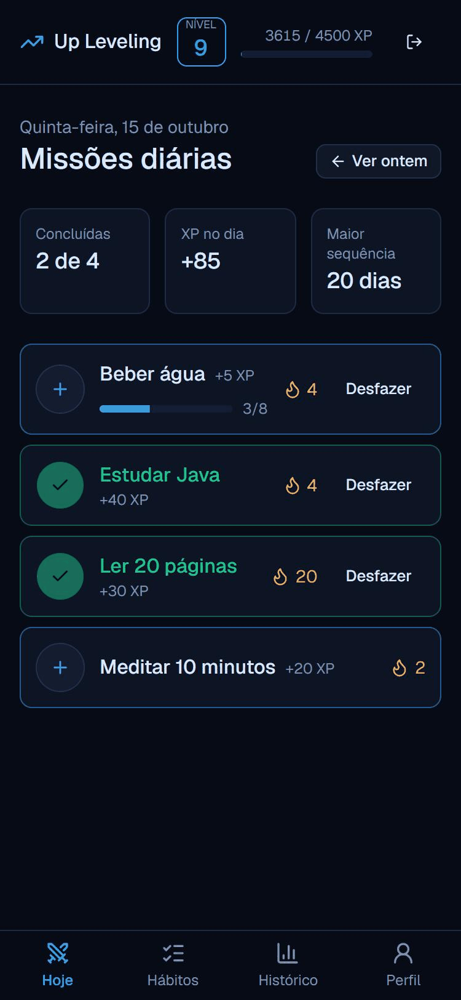

# 🎮 Up Leveling Web


Frontend do **Up Leveling**: hábitos gamificados, no estilo da "janela do Sistema" de _Solo Leveling_. Cumpra seus hábitos, ganhe XP, mantenha sequências e suba de nível.

**No ar:** https://up-leveling-web.vercel.app (entre com a **conta demo**, sem cadastro) · **API:** [up-leveling](https://github.com/RodrigodSantos/up-leveling) · [Swagger](https://up-leveling-api.onrender.com)

> A API está no plano gratuito do Render e "dorme" sem uso: o primeiro acesso pode levar até 1 minuto (o app avisa).

<p align="center">
  
  &nbsp;
  
</p>

## ✨ Funcionalidades

- **Missões diárias:** check-in com meta por dia (ex.: 3/8 copos de água), sequência 🔥, desfazer, "ver ontem" e a janela **"Você subiu de nível"** quando o XP passa do nível
- **Hábitos:** criar, editar, pausar/reativar e excluir (com confirmação), com filtro e dias da semana
- **Histórico:** gráfico de XP por dia (7, 30 ou 90 dias) e lista de check-ins agrupada por dia, com filtro por hábito e paginação
- **Perfil:** nível, dados da conta, troca de senha e aparência (modo claro/escuro e **qualquer cor de destaque**, escolhida num arco-íris, com 5 atalhos)
- **Entrada:** login, cadastro e conta demo, com a tela animada da "janela do Sistema"
- **Celular:** menu fixo no rodapé e cabeçalho de uma linha

## 🧠 Decisões técnicas

- **Dados da API com TanStack Query.** Cada dado tem uma chave de cache (`['today', 'hoje']`, `['habits', 'ativos']`…). Depois de um check-in, a barra de XP muda na hora com o progresso que vem na resposta (`setQueryData`), e o resumo do dia é buscado de novo (`invalidateQueries`).
- **Estado na URL.** Filtros, período do gráfico, página e "ontem" ficam na URL (`/historico?periodo=7&pagina=2`): F5, voltar do navegador e link compartilhado abrem a tela igual.
- **Erros da API nos campos.** O backend responde no formato RFC 9457 (Problem Details); o cliente transforma em `ApiError`, e o formulário mostra cada erro no campo certo (ex.: e-mail já cadastrado).
- **Cada tela é carregada sob demanda** (`lazy` nas rotas). O arquivo principal caiu de 697 kB para 380 kB, e o Recharts (o mais pesado) só vem com o Histórico. Se um deploy novo sair com o app aberto, a tela de erro oferece recarregar.
- **Acessibilidade:** título da aba por tela, foco no título ao trocar de tela, link "Pular para o conteúdo", botões com nome completo para leitor de tela ("Fazer check-in: Ler"), áreas de toque de 44 px no celular e animações desligadas para quem pede "reduzir movimento".
- **Cor de destaque calculada em OKLCH.** A pessoa escolhe só a matiz (0–359°); o tom de cada modo sai de uma interpolação entre as 5 cores originais, com a saturação reduzida até caber na tela e a luminosidade ajustada até o contraste passar de 4,5:1 (WCAG). Um teste confere as 360 matizes nos dois modos.
- **Animações só com CSS e React**, sem biblioteca (a tela de entrada e a janela de nível somam cerca de 6 kB).

## 🧪 Testes

**81 testes** com Vitest e Testing Library, rodando no CI a cada push (junto com lint, formatação, tipos e build):

- **Fluxo principal:** cria a conta → cria um hábito → faz o check-in → vê o XP no cabeçalho e no histórico, contra uma API falsa que guarda estado entre as telas
- **Cada tela:** caminho feliz, validações no navegador, erros da API (401, 409, 422, 500) e "Tentar de novo"
- **Rotas:** telas protegidas, redirecionamentos, foco e título ao trocar de tela, tela de erro quando o arquivo da tela não chega
- **Detalhes de comportamento:** a ordem das janelas animadas ao redimensionar e o aviso de "servidor acordando" (com relógio falso)

## 🛠️ Stack

- **React 19** + **TypeScript**, com **Vite**
- **Tailwind CSS 4** + **shadcn/ui** (componentes acessíveis, sobre o Radix)
- **React Router** (rotas) e **TanStack Query** (dados da API, cache e atualização)
- **React Hook Form** + **Zod** (formulários e validação) e **Recharts** (gráfico)
- **Vitest** + **Testing Library** (testes) e **oxlint** + **Prettier** (padrão de código)
- Deploy na **Vercel**, CI no **GitHub Actions**

## 🚀 Como rodar

Pré-requisito: Node 22.

```bash
npm install
npm run dev
```

Abre em http://localhost:5173. Por padrão, o front chama a API em `http://localhost:8080` (o backend rodando local). Para usar a API publicada, crie um `.env.local`:

```bash
VITE_API_URL=https://up-leveling-api.onrender.com
```

### Scripts

| Comando             | O que faz                                           |
| ------------------- | --------------------------------------------------- |
| `npm run dev`       | Servidor de desenvolvimento, com recarga automática |
| `npm test`          | Testes (Vitest)                                     |
| `npm run lint`      | Lint (oxlint)                                       |
| `npm run typecheck` | Checagem de tipos do TypeScript                     |
| `npm run format`    | Formata o código (Prettier)                         |
| `npm run build`     | Gera a versão de produção em `dist/`                |
| `npm run preview`   | Serve o build de produção localmente                |

## 📁 Estrutura

```
src
├── app/            # rotas (carregadas sob demanda), providers e o teste do fluxo principal
├── features/       # uma pasta por tela: componentes, chamadas à API, validações e testes
│   ├── auth/       # login, cadastro, conta demo e a tela animada de entrada
│   ├── today/      # missões do dia: check-in, desfazer, sequência e subiu de nível
│   ├── habits/     # lista, formulário de criar/editar, pausar e excluir
│   ├── history/    # gráfico de XP e check-ins agrupados por dia
│   └── profile/    # nível, dados da conta, senha e aparência
├── components/
│   ├── layout/     # cabeçalho, menu, barra de XP e tela de erro das rotas
│   ├── form/       # campo de formulário e erros da API nos campos
│   ├── system/     # peças da "janela do Sistema" (texto digitado, animações)
│   └── ui/         # componentes do shadcn/ui (botão, modal...)
├── lib/
│   ├── api/        # cliente HTTP: token, JSON e erros da API (RFC 9457)
│   ├── auth/       # sessão, AuthProvider (useAuth) e porteiros das rotas
│   └── theme/      # cor de destaque: cálculo em OKLCH com contraste garantido
└── test/           # configuração dos testes e API simulada
```

## 🗺️ Roadmap

- [x] Fundação: Vite, Tailwind, shadcn/ui, rotas, cliente da API, testes, CI
- [x] Login, cadastro e conta demo (rotas protegidas, sessão com expiração)
- [x] Missões diárias: check-ins, meta diária, sequência, barra de nível e janela de subiu de nível
- [x] Hábitos: criar, editar, pausar e excluir
- [x] Histórico com gráfico de XP e perfil
- [x] Tela de entrada "janela do Sistema"
- [x] Acabamento: celular, carregamento por tela, estados de erro, acessibilidade e testes do fluxo principal
